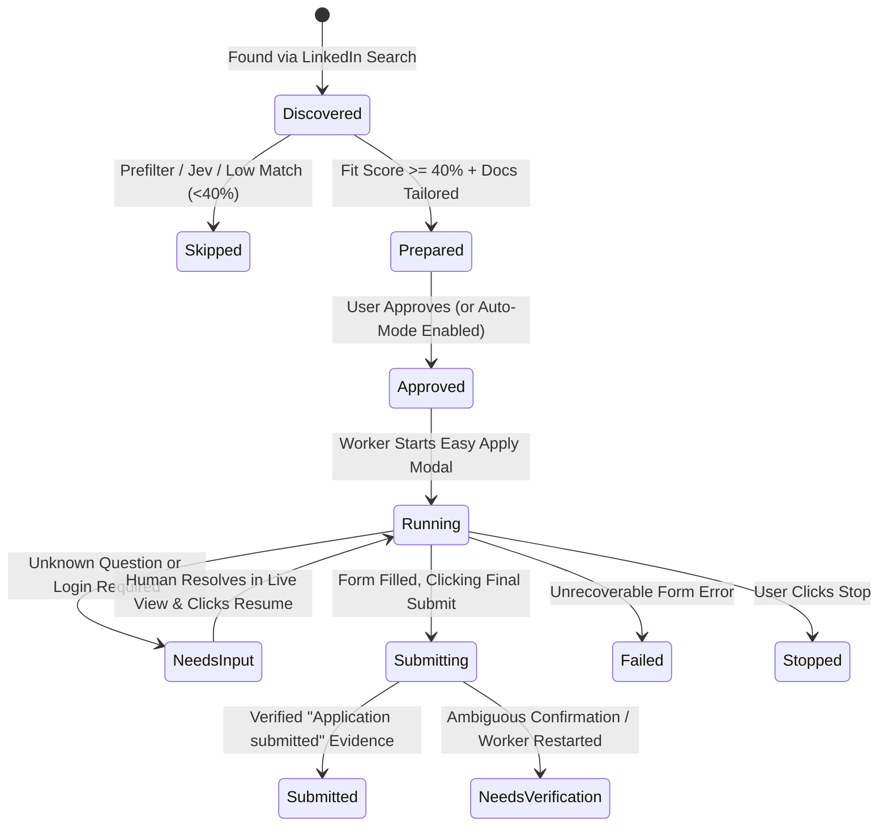

# Orbit: AI Agent vs. Automation & Application Status Guide

This document breaks down two things in crystal-clear detail:
1. **The Technical Truth**: Why this is called an AI Agent vs. why it is actually a Python automation bot.
2. **Application Status Lifecycle**: Every state an application goes through from initial discovery to submission, what each status means, and how progress is tracked.

---

# Part 1: Is This Really an AI Agent or a Python Automation Bot?

### The Short Answer
It is an **AI-Augmented Python Automation Bot** (also known as *AI-Powered Robotic Process Automation*).

The backbone and orchestrator of the entire system is **pure Python code using Playwright**. AI models (DeepSeek and Jev) act as **specialized helper microservices** called by Python for reading comprehension, scoring, and writing.

---

### Division of Labor: Python Code vs. AI Models

| Functionality | Who Does It? | The Actual Mechanism |
| :--- | :--- | :--- |
| **Launching & driving the browser** | 🐍 **Python (Playwright)** | Opens a Chromium cloud browser via Browserbase, handles tabs, navigates URLs. |
| **Finding HTML elements & buttons** | 🐍 **Python / JavaScript** | Uses JavaScript DOM queries (`deepAll` across shadow roots) to locate buttons and inputs. |
| **Title filtering (e.g. dropping 'Senior')**| 🐍 **Python (Regex)** | Checks if keywords like `senior`, `lead`, `principal` exist in the title string. Zero AI used. |
| **Checking minimum years required** | 🐍 **Python (Regex)** | Regex matches phrases like `3+ years` or `minimum 4 years` and compares numbers in code. |
| **Fast job viability triage** | 🤖 **AI (Jev 1.13 via OpenRouter)** | Fast yes/no questions: *Is this an AI or software role? Is this an internship/fresher role?* |
| **Detailed job fit evaluation** | 🤖 **AI (DeepSeek V4)** | Reads full job description and user profile, evaluates skills match, and outputs a 0–100% score. |
| **Tailoring resume & cover letter** | 🤖 **AI (DeepSeek V4)** | Rewrites resume bullet points and crafts a cover letter tailored to the job description. |
| **Filling contact info (Name, Email, Phone)**| 🐍 **Python Code** | Standard rule-based filling. Reads confirmed user profile and types into input elements. |
| **Answering non-standard screening questions**| 🤖 **AI / Database** | Queries confirmed database answers; calls AI only if planning custom form steps. |
| **Detecting CAPTCHAs & Logins** | 🐍 **Python Code** | Detects challenge URLs or login screens and triggers a pause for human takeover. |
| **Submitting the form** | 🐍 **Python Code** | Finds and clicks the final `Submit application` button in the LinkedIn dialog. |

---

### Why People Call It an "AI Agent" (The Pros)
1. **Semantic Understanding**: Unlike a traditional bot that only searches for exact keywords (e.g., `Python`), an LLM understands semantic context. It knows that *"FastAPI microservices experience"* matches a *"Python backend"* background.
2. **Autonomous Goal Execution**: You press **Start Agent** once, and it independently navigates searches, filters out hundreds of irrelevant postings, evaluates matches, and prepares applications.
3. **Dynamic Content Generation**: It does not submit a one-size-fits-all PDF. It dynamically writes custom resumes and cover letters for each specific role.
4. **Adaptive Form Handling**: When an application form has unusual phrasing, an LLM plans how to answer the questions based on user facts rather than crashing.

---

### Why It Is NOT a True Autonomous AI Agent (The Engineering Reality)
1. **Python Controls the Loop, Not the AI**:
   * A true agent (like AutoGPT, Devin, or Claude Computer Use) decides what action to take next (*"Should I search? Should I scroll? Should I click this link?"*).
   * Here, the logic is **rigid Python code**:
     ```python
     # Python dictates the entire sequence:
     for job in search_results:
         if is_senior_title(job): skip()
         if exceeds_experience(job): skip()
         score = ask_deepseek(job)
         if score < 40: skip()
         worker.apply_to_job(job)
     ```
     The AI has no agency to change this loop or explore on its own.
2. **No Vision or Spatial Awareness**:
   * It does not "see" the screen. It uses regular browser automation (Playwright and DOM tree selectors).
3. **Cannot Self-Heal on Layout Changes**:
   * If LinkedIn redesigns its Easy Apply dialog or changes element classes, the AI cannot figure out where the button moved. The Python developer must update `backend/linkedin.py`.
4. **Strict Guardrails**:
   * The AI is strictly barred from making up answers, guessing passwords, or proceeding without human verification.

---

# Part 2: Application Status & Progress Lifecycle

Every job tracked in Orbit moves through a strictly defined state machine.



---

### 1. Application Status Badges (Stored in `applications.status`)

These are the exact statuses shown on the UI dashboard:

| Status Badge | UI Label | What It Means Under The Hood |
| :--- | :--- | :--- |
| `prepared` | **Ready for review** | The job passed all filters, DeepSeek rated it a match (≥40%), and tailored resume/cover letter documents have been written. Waiting for approval. |
| `approved` | **Approved** | The application package was approved by the user (or automatically approved if Auto-Mode is enabled). It is queued for the browser worker. |
| `running` | **Applying** | The Playwright browser worker is actively navigating LinkedIn, opening the Easy Apply dialog, and filling form inputs. |
| `needs_input` | **Needs your input** | The agent paused because LinkedIn showed a login screen/CAPTCHA, OR the form asked a screening question that has no confirmed answer in your profile. |
| `submitting` | **Submitting** | All form pages are filled; the bot has clicked the final submit button and is awaiting the confirmation screen. |
| `submitted` | **Applied** | Confirmed! The worker detected LinkedIn's official *"Application submitted"* confirmation screen. |
| `needs_verification`| **Verify submission** | The application finished or restarted in an ambiguous state (e.g. server rebooted while submitting). It is never retried automatically to prevent duplicate spam. |
| `paused` | **Paused** | The user temporarily paused the agent or application run. |
| `stopped` | **Stopped** | The application was manually cancelled by the user. |
| `failed` | **Failed** | An unexpected error occurred (e.g. LinkedIn session expired or button not clickable). |

---

### 2. Agent Run Phases (Stored in `agent_runs.phase`)

While the agent is actively executing, the top-level agent run displays its current phase:

1. **`searching`**: The agent is generating LinkedIn search queries, loading search result pages, and collecting new vacancies.
2. **`evaluating`**: The agent is running candidates through the prefilter rules, Jev triage, and DeepSeek match scoring.
3. **`applying`**: The agent has handed off an approved job to `worker.py` and is currently filling out the Easy Apply modal.
4. **`paused`**: The agent is temporarily halted awaiting user intervention or a "Resume" command.

---

### 3. Skipped Jobs & Why They Never Enter Applications

If a job is discarded during the funnel, it is saved to the `skipped_jobs` table so the agent never wastes time or money opening it again:

* **`too_senior`**: Title contains words like *Senior, Lead, Principal, Architect, Director, Manager*.
* **`non_tech`**: Title matches non-software roles (e.g., sales, marketing, recruiter).
* **`experience_too_high`**: Job posting description demands more years of experience than the user has (e.g., *“3+ years of experience required”* for a Fresher).
* **`no_easy_apply`**: The job requires an external company portal redirect rather than LinkedIn Easy Apply.
* **`jev_triage_mismatch`**: Jev's fast binary checks determined the job is not an entry-level software/AI role.
* **`low_fit_score`**: DeepSeek rated the profile match below the 40% threshold.
* **`already_applied`**: Duplicate canonical job URL already processed in the database.
* **`missing_confirmed_answers`**: The application form asked a question with no approved answer in the user's profile.

---

### 4. Real-Time Tracking & Live View

The user tracks real-time progress through three coordinated channels:

1. **Server-Sent Events (SSE)**: The backend exposes `/api/events`. Whenever an application status changes or an event is logged, an SSE signal triggers an instant UI update without page reload.
2. **Activity Timeline**: Every micro-step (*"Opened search results", "Skipped job: Senior Dev", "Tailored cover letter in 6.2s", "Filling step 2 of 4"*) is logged with timestamps in the right-hand panel.
3. **Embedded Browserbase Live View**: An interactive `<iframe>` displays the live cloud browser session. If a login or challenge is detected, the user can take control and click/type directly inside the embedded window.
