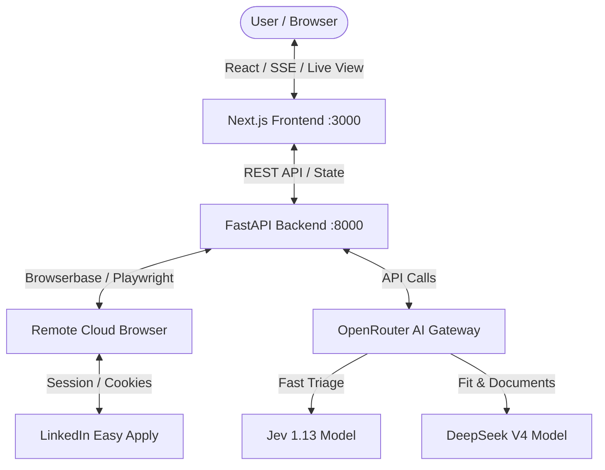
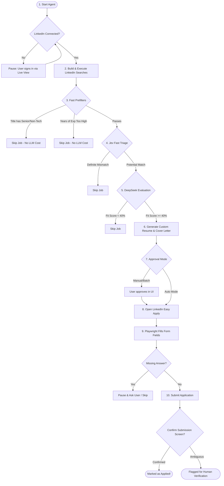

# How Orbit Works: AI Agent vs. Automation Explained

A plain-language guide explaining how this project is built, whether it is an AI agent or automation, and its complete end-to-end workflow.

---

## 1. Quick Answer: Is this an AI Agent or Automation?

**It is a Hybrid System (Rule-based Automation + AI Decision Agent).**

It is neither just a dumb script (pure automation) nor an unpredictable autonomous bot (pure AI):

| Aspect | Rule-Based Automation | AI Agent | Orbit (This Project) |
| :--- | :--- | :--- | :--- |
| **Finding Jobs** | Uses predetermined search URLs & keywords | Decides search queries on the fly | **Automation** (Constructs strict search queries based on your profile) |
| **Initial Filtering** | Skips senior titles, checks minimum years | Semantic understanding of job context | **Both** (Rules first to save cost, followed by AI fast-triage) |
| **Job Fit Evaluation** | Keyword matching | Semantic match analysis & reasoning | **AI Agent** (DeepSeek rates match score and writes evidence report) |
| **Resume & Cover Letter** | Fixed template / static file | Dynamically tailored content | **AI Agent** (DeepSeek tailors resume points & cover letter to job requirements) |
| **Browser Control** | Playwright clicks buttons & fills text fields | Vision/LLM controls browser | **Smart Automation** (Playwright + Shadow-DOM parsing for LinkedIn) |
| **Form Answers** | Hardcoded key-value mapping | Generates answers to questions | **Hybrid** (Standard fields answered by rules; unknown questions handled by AI or escalated to human) |
| **Logins & CAPTCHAs** | Tries to bypass or fails | Tries to solve | **Human Gate** (Pauses and lets the human solve in Live View) |

---

## 2. High-Level Architecture

The project consists of three main layers:

1. **Frontend (`app/`)**: Built with **Next.js & React**. Provides onboarding wizard, dashboard, live application tracker, and an embedded **Live View** screen to watch or take over the browser.
2. **Backend (`backend/`)**: Built with **FastAPI (Python)**. Coordinates background tasks, database storage (SQLite / PostgreSQL), AI prompts, and browser control.
3. **Browser Engine (`backend/worker.py`, `backend/linkedin.py`)**: Uses **Playwright** connected to **Browserbase** (cloud browser environment) with persistent user profiles so login sessions stay active across runs.
4. **AI Models (via OpenRouter)**:
   - **Jev (`typesafe/jev-1.13`)**: Ultra-fast (sub-second) binary and multiple-choice decision maker for quick job screening.
   - **DeepSeek (`deepseek/deepseek-v4-flash-0731`)**: Detailed job-matching assessment, document generation (custom resume & cover letter), and planning steps for complex form questions.

---

## 3. Step-by-Step Workflow

Here is the exact journey from the moment you click "Start Agent" to when a job is marked "Applied":

---

### Phase 1: Authentication & Safety First
1. **Connect LinkedIn Gate**:
   - The agent will **never** ask for your LinkedIn password and will **never** try to solve CAPTCHAs automatically.
   - You open the **Live View** window inside the web app and log in manually to LinkedIn.
   - The browser profile is saved via **Browserbase**. For future runs, your session stays active automatically.

---

### Phase 2: Searching for Jobs
1. Based on your onboarded profile (e.g., *Career Stage*: Intern, Fresher, or Experienced) and target roles, the agent constructs targeted LinkedIn search URLs.
2. It enforces filters:
   - **Easy Apply only** (`f_AL=true`).
   - Posted within the past week.
   - Sorted by newest first.
   - Matching experience level tags.

---

### Phase 3: The "Cost-Saving" Funnel (Cheapest Checks First)
Before calling expensive AI models, the code eliminates unqualified jobs in stages:
1. **Deduplication**: If the job URL or ID is already in the database, it is skipped instantly.
2. **Title Filter (Free / Zero AI)**: Drops titles asking for "Senior", "Lead", "Staff", or non-tech jobs directly from the search results without even opening the job page.
3. **Experience Check (Free / Zero AI)**: Scans the job description text using regex. If it explicitly demands more years of experience than you have (e.g., "minimum 3 years" when you are a Fresher), it skips immediately.
4. **Jev Fast Triage (Micro-Cent AI)**: A lightweight model (`typesafe/jev-1.13`) answers basic atomic questions (e.g. *Is this job an AI/Software role? What is the minimum experience?*). If it's a confident mismatch, it skips without further model calls.

---

### Phase 4: AI Deep Evaluation & Document Tailoring
1. **DeepSeek Match Scoring**:
   - DeepSeek reads the full job description and compares it against your parsed profile and skills.
   - It outputs a fit score (0–100%). For Fresher/Junior roles, it requires at least a **40% match** to proceed.
2. **Tailored Documents**:
   - If the job passes, DeepSeek crafts a customized resume and cover letter emphasizing your matching strengths for that exact job posting.

---

### Phase 5: Approval Gate
Depending on your preference settings:
- **Individual Mode**: You review each job and approve tailored documents one-by-one.
- **Batch Mode**: You review and approve a list of matching jobs together.
- **Automatic Mode**: If explicitly enabled by you, the agent proceeds directly to application.

---

### Phase 6: Automated Form Filling (`backend/worker.py`)
1. **Shadow-DOM Navigation**:
   - LinkedIn's Easy Apply modal is housed inside a Shadow DOM, making standard scraper selectors fail. Orbit uses custom JavaScript helpers (`SNAPSHOT_JS`) to discover inputs inside nested shadow roots.
2. **Rules-First Execution**:
   - Standard fields (first name, last name, email, phone number, attaching the tailored PDF) are filled using strict rules with **no AI calls**.
3. **Handling Screening Questions**:
   - For dropdowns, checkboxes, or text questions:
     - The agent checks your saved answers in the database (e.g., citizenship status, sponsorship requirements, years of experience with Python).
     - If a question cannot be answered truthfully with your confirmed profile data, the agent **will not guess or lie**. It stops and marks the job for your review.
4. **Submission Verification**:
   - The agent looks for explicit confirmation evidence (e.g., LinkedIn's "Application submitted" screen). Only then is the job recorded as `Applied`.
   - If anything looks ambiguous, it marks it as `needs_verification` and pauses for safety.

---

## 4. Key Files and What They Do

| File / Folder | Role | Description |
| :--- | :--- | :--- |
| [backend/main.py](file:///Users/arunsudhaveni/job-agent/backend/main.py) | **API Server** | FastAPI entry point, handles endpoints for profile onboarding, starting/stopping agent runs, and SSE real-time events. |
| [backend/platform_agent.py](file:///Users/arunsudhaveni/job-agent/backend/platform_agent.py) | **Core Loop** | Orchestrates searching LinkedIn, filtering jobs through the funnel, calling AI evaluation, and queuing applications. |
| [backend/worker.py](file:///Users/arunsudhaveni/job-agent/backend/worker.py) | **Browser Driver** | Playwright controller that clicks Easy Apply, traverses Shadow-DOM dialogs, fills form fields, and submits applications. |
| [backend/linkedin.py](file:///Users/arunsudhaveni/job-agent/backend/linkedin.py) | **LinkedIn Specifics** | LinkedIn modal selectors, search URL builders, and UI element locators. |
| [backend/jev.py](file:///Users/arunsudhaveni/job-agent/backend/jev.py) | **Fast Triage** | Connects to `typesafe/jev-1.13` for sub-second job viability screening. |
| [backend/career_ops.py](file:///Users/arunsudhaveni/job-agent/backend/career_ops.py) | **AI Prompts** | Prompts and constraints for DeepSeek fit evaluations and resume tailoring. |
| [backend/human_gate.py](file:///Users/arunsudhaveni/job-agent/backend/human_gate.py) | **Safety Gates** | Detects login pages, CAPTCHAs, or 2FA checks, triggering a human intervention pause. |
| [backend/db.py](file:///Users/arunsudhaveni/job-agent/backend/db.py) | **Database** | SQLAlchemy models for users, applications, job posts, and connection states. |
| [app/](file:///Users/arunsudhaveni/job-agent/app) | **Frontend** | Next.js user interface: Onboarding wizard, application tracking dashboard, and embedded Live View. |

---

## 5. Built-in Safety & Limits

- **Account Protection**: Hard cap of max 10 real applications per day (configurable) and random 3–7 second delays between actions to mimic natural human pacing.
- **Budget Protection**: Stops automatically when model spend exceeds a predefined budget limit (default `$1.00` per run).
- **Anti-Hallucination**: The AI is forbidden from making up qualifications or answers to screening questions that you have not confirmed.
- **Privacy & Security**: Credentials and sessions remain securely managed inside Browserbase cloud browser profiles; the agent never logs your passwords.
