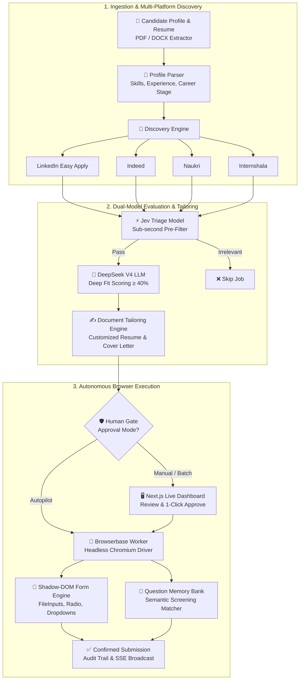

# ⚡ Autonomous AI Job Agent

<p align="center">
  
</p>

<p align="center">
  <strong>Autonomous Multi-Platform Job Search • Intelligent Matching • Auto-Application Agent</strong><br>
  An intelligent, agentic workflow that discovers jobs across LinkedIn, Indeed, Naukri & Internshala, screens compatibility via dual-model LLM triage, dynamically tailors resumes and cover letters, and executes verified Easy Apply submissions through headless browser automation.
</p>

<p align="center">
  
  
  
  
  
  
  
</p>

---

## 🎯 What it does

The **Autonomous AI Job Agent** eliminates the tedious, repetitive grind of manual job applications. Instead of spending 20+ hours every week searching portals, re-uploading resumes, and manually typing answers to repetitive screening questions, the agent manages the entire application lifecycle end-to-end.

It continuously monitors major job boards, filters out irrelevant or senior positions, calculates precise candidate-job fit scores, customizes application materials, and navigates complex shadow-DOM web forms to submit applications autonomously.

### ⚡ Manual Job Hunting vs. Autonomous AI Job Agent

| Dimension | Manual Job Search | Autonomous AI Job Agent |
|---|---|---|
| **Application Speed** | 20–30 minutes per application | **< 45 seconds** per job end-to-end |
| **Portal Coverage** | Manually cycling through 4+ websites | Unified parallel discovery (**LinkedIn, Indeed, Naukri, Internshala**) |
| **Resume Matching** | Generic, single-version PDF submissions | **Dynamic tailoring:** Rewrites bullet points to match JD keywords |
| **Form Filling** | Repetitive manual typing & drop-down selects | **Headless Chromium automation** handling shadow-DOM inputs |
| **Screening Questions** | Typing the same answers dozens of times | **Self-learning Question Memory** with semantic auto-matching |
| **Control & Safety** | 100% manual burden | **Human-in-the-Loop Gates:** 1-click approvals, batching, or full autopilot |

---

## 🧩 Architecture



---

## 🛠️ Pipeline Stages & Engineering Breakdown

| Stage | Module | What Happens |
|---|---|---|
| **1. Ingest & Parse** | `backend/resume_parser.py` | Extracts structured candidate details (skills, work history, education, authorization) from PDF, DOCX, and TXT files (up to 5 MB). |
| **2. Multi-Platform Discovery** | `backend/discovery/` | Concurrent discovery engine querying LinkedIn Easy Apply, Indeed, Naukri, and Internshala with query generation, URL deduplication, and freshness filters. |
| **3. Dual-Model Triage** | `backend/jev.py` & `backend/ai_engine.py` | Cost-optimized routing: **Jev** handles instant deterministic pre-filtering ($0.001/run), while **DeepSeek V4** evaluates deep semantic fit and job alignment. |
| **4. Document Tailoring** | `backend/document_engine.py` | Rewrites relevant resume experience bullets and crafts personalized cover letters tailored to the extracted requirements of the specific JD. |
| **5. Form Navigation & Execution** | `backend/worker.py` & `backend/platform_agent.py` | Drives persistent cloud/local browser sessions, pierces shadow-DOM elements on job platforms, and fills complex nested inputs without bot triggers. |
| **6. Self-Learning Memory** | `backend/question_memory.py` | Automatically stores answers to unique portal questions (e.g., notice period, sponsorship, compensation) and retrieves them via semantic similarity. |
| **7. Real-Time Tracking UI** | `app/page.tsx` & `app/agent-panels.tsx` | Modern Next.js interface with real-time SSE event feeds, interactive application status charts, Live View embedded streams, and human-gate toggles. |

---

## 🧠 Key Design Decisions & Technical Highlights

* **Dual-Model Economics:** Calling heavy LLMs for thousands of raw vacancies is prohibitively expensive. The agent routes candidates through **Jev** (a sub-second fast triage model) to discard obvious mismatches, reserving **DeepSeek V4** exclusively for promising candidates.
* **Shadow-DOM & Anti-Bot Traversal:** Modern job portals (especially LinkedIn) encapsulate form controls inside nested shadow roots. The automation engine leverages specialized locators and persistent browser profiles (via Browserbase) to bypass bot blocks and avoid repeat logins.
* **Zero Accidental Submissions (Human-in-the-Loop):** Candidates retain full control. The system supports three execution modes:
  1. *Manual Review:* Inspect every tailored resume and proposed answer before sending.
  2. *Batch Review:* Approve multiple vetted jobs with a single click.
  3. *Autonomous Autopilot:* Fully autonomous execution with real-time SSE monitoring and safety kill-switches.
* **Confirmed Submission Evidence:** Applications are only marked as `Applied` once cryptographic evidence (final URL confirmation, confirmation DOM anchor, and snapshot proof) is verified by the backend.

---

## 🚀 Quick Start

### 1. Clone & Set Up Python Environment

```bash
git clone https://github.com/Arunlucky2610/AI-JOB-AGNET.git
cd AI-JOB-AGNET

# Create and activate Python virtual environment
python -m venv .venv
source .venv/bin/activate       # On Windows: .\.venv\Scripts\activate

# Install backend dependencies
pip install -r backend/requirements.txt
```

### 2. Set Up Frontend Environment

```bash
# Install Node.js dependencies
npm install
```

### 3. Configure Environment Variables

Copy the template file to `.env`:

```bash
cp .env.example .env
```

Populate your API keys in `.env`:

```dotenv
API_INTERNAL_URL=http://127.0.0.1:8000
DATABASE_URL=sqlite:///./data/orbit.db
APP_ORIGIN=http://127.0.0.1:3000

# LLM Providers (via OpenRouter or direct)
OPENROUTER_API_KEY=your_openrouter_api_key

# Browserbase / Headless Browser (Optional: Set USE_LOCAL_BROWSER=true to run locally)
USE_LOCAL_BROWSER=true
LOCAL_BROWSER_HEADLESS=false
BROWSERBASE_API_KEY=your_browserbase_api_key

# Location Autocomplete (Optional)
LOCATIONIQ_API_KEY=your_locationiq_api_key
```

### 4. Run the Application

Launch the FastAPI backend:
```bash
uvicorn backend.main:app --host 127.0.0.1 --port 8000 --reload
```

In a separate terminal, launch the Next.js frontend:
```bash
npm run dev
```

Open **[http://localhost:3000](http://localhost:3000)** in your browser to start your autonomous job search!

---

## 📁 Project Structure

```text
AI-JOB-AGNET/
├── app/                           # Next.js 15 Frontend
│   ├── page.tsx                   # Main Dashboard & Live View
│   ├── onboarding.tsx             # 5-step Profile & Preferences Onboarding
│   ├── agent-panels.tsx           # Real-time Telemetry & Log Panels
│   ├── agent-flowchart.tsx        # Interactive Architecture Flowchart
│   └── globals.css                # Dark modern aesthetic & animations
├── backend/                       # FastAPI & Python Agent Backend
│   ├── main.py                    # REST API & SSE Event Streams
│   ├── agent.py                   # Central Agent Execution Orchestrator
│   ├── platform_agent.py          # Unified Multi-Platform Dispatcher
│   ├── worker.py                  # Headless Browser Automation Engine
│   ├── document_engine.py         # Dynamic Resume & Cover Letter Tailoring
│   ├── question_memory.py         # Screening Question Memory & Semantic Matcher
│   ├── discovery/                 # Multi-Platform Vacancy Providers
│   │   ├── engine.py              # Aggregation & Deduplication Logic
│   │   ├── platform_providers.py  # Platform Adaptors (LinkedIn, Indeed, etc.)
│   │   └── query_generator.py     # Search Keyword & Query Optimizer
│   ├── services.py                # LLM API & Browserbase Connectors
│   ├── db.py                      # SQLAlchemy Models & SQLite Persistence
│   └── resume_parser.py           # Document Ingestion (PDF / DOCX)
├── data/                          # Local Database & Storage
├── public/                        # Static Assets, Icons & Logos
├── scratch/                       # Test & Validation Scripts
└── requirements.txt               # Python Dependencies
```

---

## 👨‍💻 Author

**Arun Sudhaveni** · Computer Science Engineering  
*CMR Technical Campus (CMRC)*

[](https://github.com/Arunlucky2610)
[](https://linkedin.com)

`Autonomous Agents` · `GenAI & LLMs` · `Full-Stack AI` · `Next.js & FastAPI` · `Browser Automation`
